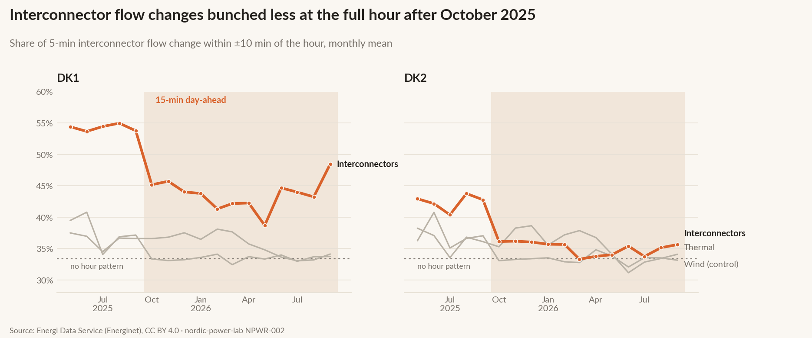
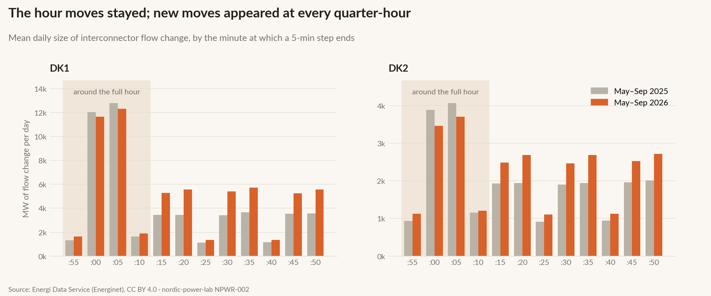
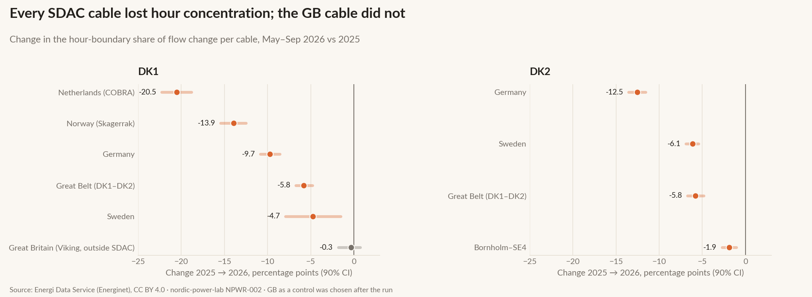
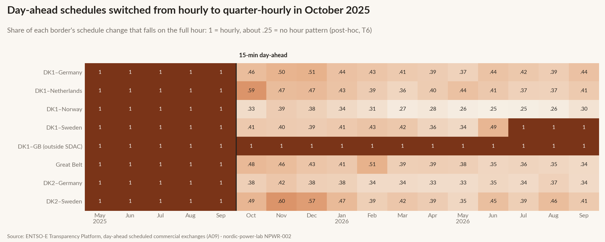
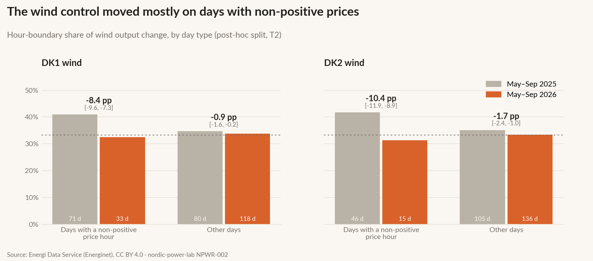
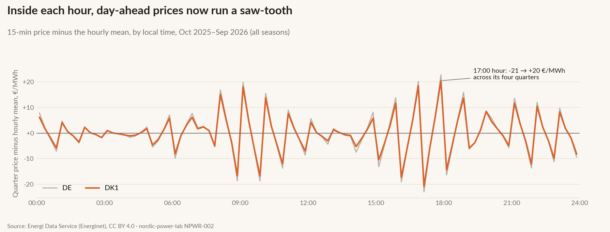
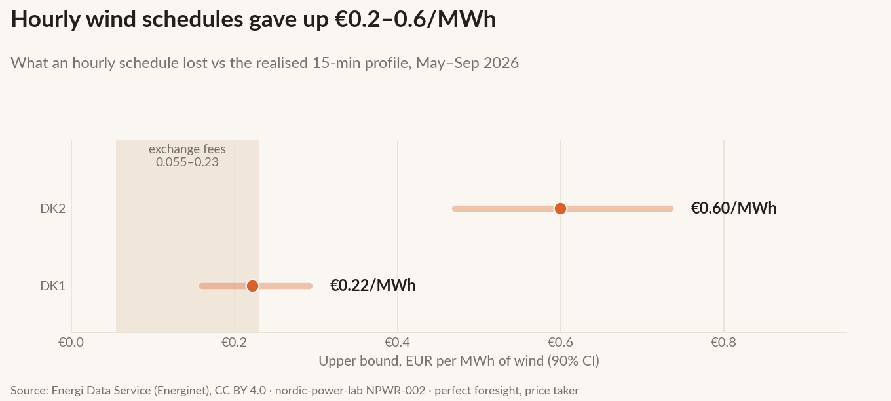
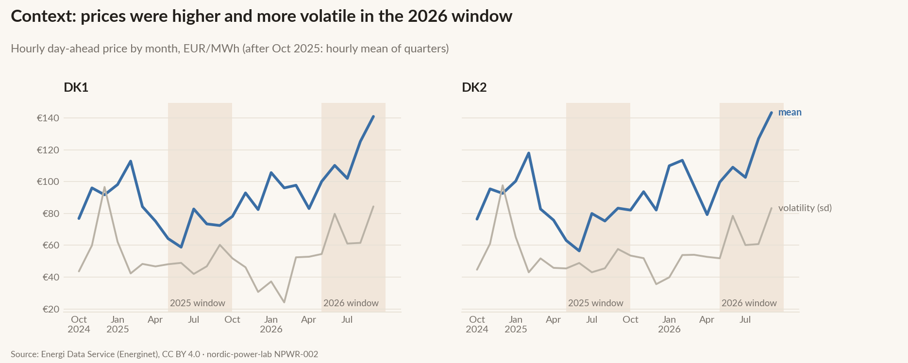

# What changed in Danish interconnector flows as markets went to 15 minutes (March and October 2025)

Descriptive study. Data: Energi Data Service (Energinet, CC BY 4.0) and ENTSO-E Transparency Platform.
The analysis plan was committed before any outcome statistic was computed; every look and every departure
from the plan is logged.

## Result in one paragraph

In DK1 and DK2, the share of 5-minute interconnector flow change that happens within ±10 minutes of the full hour fell
by **10.5 pp** (54.2% → 43.8%, 90% CI −12.4 to −8.7, 28-day block bootstrap) and **7.6 pp** (42.4% → 34.8%, CI −8.5 to −6.7)
between May–Sep 2025 and May–Sep 2026, with a step dated 30 Sep/1 Oct 2025 by a changepoint search without
candidate dates (−9.1 / −6.4 pp over 28 days), when the European day-ahead market (SDAC) moved to 15-minute
products. DK2 also fell 3 pp at the same calendar date in 2024, so not all of the step is the switch. The size of changes at the hour stayed about the same; changes elsewhere in the hour grew
(+52% DK1, +31% DK2). Under the pre-registered rules the claim is capped at *"possibly a measurement change"*, because the
wind control also moved. Checks run after the main analysis (labelled post-hoc below) point to a market cause:
the day-ahead schedules themselves (ENTSO-E, an independent non-SCADA source) went from strictly hourly to
quarter-hourly on every SDAC border in October 2025, the GB cable, which is outside SDAC, stayed hourly in
both sources, and the wind control moved mostly on negative-price days, which fits (but does not prove) hourly
curtailment becoming quarter-hourly.

**It is the second of two stages.** The hour-boundary share had already fallen in March 2025, when quarter-hour
steps first appeared on Danish cables (Nordic mFRR energy activation market, 4 March; 15-minute intraday and
imbalance prices, 19 March). Its size is hard to state: on 18 Feb 2025 the HVDC ramp on the Nordic cables
shortened from 20–30 to 10 minutes, and the measure depends on the ramp length (see Limitations). A summer 2023 vs
2024 placebo moved +2.2 / +1.0 pp, so the share is not drifting down on its own.

## Why this question

Since 2025-10-01 SDAC trades day-ahead in 15-minute products. Nordic HVDC rules require each schedule change to
ramp within ±5 minutes of an MTU shift ([Nordic LFC ramping methodology, 2024][r3];
[DE-LU-DK determination, 2024][r4]), so hourly schedules put most interconnector movement around the full hour. Quarter-hourly
schedules should spread it. The direction is expected; the questions are its size in Danish physical flows, its
timing, and what else moved.

Close prior work: Böttcher et al. ([arXiv:2602.09645][r1]) show hourly components of Continental European grid
frequency weakening after the same go-live. Svenska kraftnät reports much better Nordic frequency quality in 2025, without
numbers ([SvK, Dec 2025][r2]). We found no per-cable flow analysis for Denmark.

## Data and method

- **Series**: `ElectricityProdex5MinRealtime` (upscaled SCADA measurements, 5-min), each interconnector separately:
  DK1 Great Belt, Germany, Netherlands, Great Britain, Norway, Sweden; DK2 Great Belt, Germany, Sweden, Bornholm–SE4.
- **Step** = |X(t) − X(t−5 min)| summed over the area's interconnectors.
- **H** per delivery day = share of the day's total step size in steps ending at :55, :00, :05, :10
  (covering ±10 minutes around the hour). No hour pattern gives H = 1/3.
- **Windows**: W25 = 2025-05-01..09-30, W26 = 2026-05-01..09-30, Copenhagen delivery days (151 complete days each).
  The same season in both years; both windows already had 15-min imbalance settlement and 15-min intraday trading
  (since 2025-03-19). The day-ahead switch is the largest known change between them; Nordic aFRR procurement
  also changed on 2025-10-01.
- **Contrast**: mean H(W26) − mean H(W25), bootstrap over days, 2000 draws, 90% CI; a 28-day block version
  (which respects day-to-day correlation) is reported in the results. Pre-computed minimum detectable
  effect: 0.9 / 0.7 pp.
- **Controls**: wind (onshore + offshore) is the pre-registered negative control: it has no schedule, so a change there
  signals a measurement change. Thermal production is secondary. In hindsight wind is not a control: its own
  within-hour pattern follows the market time unit (excess of hour-boundary over other quarter-boundary steps
  0.2–0.7 in every May–Sep month of 2024 and 2025, 0.0–0.12 in every May–Sep month of 2026).
- **Snapshot**: all results come from one frozen database snapshot (9 Nov 2026) with a recorded SHA-256.

## Results

**Q2, primary.** Both areas fall, with a step between September and October 2025 (DK1 0.54 → 0.45, DK2 0.43 → 0.36).
Robustness: about the same with medians, without the top 1% of days, with week blocks, without any single cable, or
without 7 days of frozen telemetry (−10.6 / −7.7 pp). Shifting the window ±5 minutes keeps the sign but shrinks
the change to −8.4…−8.9 (DK1) and −5.7…−6.8 pp (DK2). Thermal production (secondary) fell −2.7 / −3.2 pp.

**The share fell because quarter-hour steps grew, not because hour steps shrank.** Mean daily step mass at the
hour boundary: DK1 27 772 → 27 505 MW (CI includes 0), DK2 −6%. Off-boundary mass: DK1 +52%, DK2 +31% (post-hoc, T4).
Quarter-hour steps existed before (15-min intraday and imbalance since 2023–2025).

**Per cable.** Six of seven SDAC connections fell by 5.8–20.5 pp; Konti-Skan (DK1–Sweden) fell until it returned
to hourly schedules on 30 June 2026 (−4.7 pp over the window, CI includes 0). The Great Britain cable
(Viking Link), outside SDAC, stayed at H ≈ 0.99 (−0.3 pp, CI includes 0), which argues against a dataset-wide processing change
(post-hoc control).
The DK1–Sweden cable becomes hourly-like again from July 2026 (monthly H 0.33 in May → 0.62 in July). Its
day-ahead schedule is hourly again from July too (below), so this is a schedule change, not a sensor one; why the
border went back to hourly is not established (the protocol lists Konti-Skan QPRE as a candidate). It coincides
with DK1's partial rebound in late summer.

**Schedules, an independent source (post-hoc, T6).** ENTSO-E day-ahead scheduled exchanges per border: the share of
quarter-to-quarter schedule change that happens at the full hour is hourly until September 2025 (most borders are
published at hourly resolution then, so this is by construction), and 0.25–0.51 on every SDAC border from October
2025, except DK1–Sweden, which is back to hourly from July 2026. GB stays hourly throughout. After the switch,
day-ahead schedule changes explain 19–71% of the off-hour quarter-boundary flow changes, depending on the cable. A SCADA
measurement change cannot produce this, so a measurement artefact is an unlikely explanation, although the
pre-registered cap stays.

**The wind control moved**: −4.1 pp in DK1 and −3.9 pp in DK2, CI excluding 0. That triggers the pre-registered cap
(and, as noted above, wind turned out not to be a valid control).
Post-hoc splits (T2–T4) show the shift sits on days with at least one non-positive day-ahead price (DK1 41% → 33%),
while on other days it is −0.8 / −1.7 pp. About 1.6 of DK1's 4.1 pp comes only from fewer such days (71 → 33). Ordinary-day changes
still exclude 0. Wind lost hour-boundary step mass (−21% / −33%) and gained none elsewhere, the reverse of added
measurement noise. The most likely reading is that wind is not a clean
control: it is curtailed at negative prices, and curtailment followed hourly prices before October 2025. This is an
inference, not a verified mechanism; the interconnector decline is the same on ordinary days (−9.4 / −7.4 pp).

**Q1, day-ahead price shape.** After the switch almost no hour has four equal quarter prices (at most 2% of hours in any
week). The median within-hour price range is 7–22 EUR/MWh by month. Prices inside an hour show a strong saw-tooth on
ramps: in the 17:00 hour the four DK1 quarters average −21, −6, +7, +20 EUR/MWh against the hourly mean (all
seasons pooled), almost identical to Germany.

**Q3, value of 15-min resolution for aggregate wind.** If Danish wind had been scheduled at its hourly average
instead of its realised 15-min profile, and settled the difference at the imbalance price, it would have earned
0.22 EUR/MWh less in DK1 (CI 0.16–0.29) and 0.60 EUR/MWh less in DK2 (CI 0.47–0.73), May–Sep 2026. This is an upper
bound (perfect foresight of the 15-min profile, price taker). The DK1 interval overlaps the pre-registered yardstick,
Nord Pool's trading fees (0.055–0.23 EUR/MWh), so it is not distinguishable from immaterial; DK2 is above it.

**Q4, context.** Day-ahead prices were much higher and more volatile in W26 than in W25 (monthly means about
100–140 vs 57–83 EUR/MWh), see the context figure below. Flows could respond to that too; the
October 2025 timing argues against it as the main cause, but it is not ruled out.

## Follow-up checks after the audit (pre-registered, 15 Nov 2026)

- **Measurement (T11).** The 5-minute series used here equals the 1-minute PowerSystemRightNow value at the same
  minute (correlation 0.99), and the hour-boundary share computed from the 1-minute data differs by 0.2 pp
  (daily correlation 0.98 / 0.94). Live values are rarely revised. The 1-minute data start on 30 Sep 2025, so this
  confirms the measurement after the switch, not before it.
- **A measure that ignores ramp length (T12).** The share of 5-minute flow change at :20, :30, :35, :45 (positions
  an hourly ramp never reaches) rose at every candidate date, but also at the 18 Feb 2025 ramp change itself
  (+6.2 / +3.3 pp), so it is not fully ramp-proof in practice. On other HVDC cables (ENTSO-E 15-minute flows),
  the share of change into the :30 quarter rose at the day-ahead switch on NorNed (+7.8 pp) but not on NordLink;
  cables outside SDAC (North Sea Link, BritNed) did not rise. NorNed also rose at the 15-minute intraday start
  (19 Mar 2025, +11.5 pp). Pre-registered reading: partial replication.
- **Which market made the March steps (T13).** Not identifiable: ENTSO-E total schedules stayed hourly on all
  Danish HVDC borders until mid-April 2025. Off-hour flow changes correlate with mFRR energy activations
  (0.36 in DK1, descriptive only).

## What the pre-registration said, and how it scored

| Expected before the run | Prob. | Outcome |
|---|---|---|
| H lower in W26, DK1 / DK2 | 0.65 / 0.60 | yes / yes |
| CI below 0 in both areas | 0.40 | yes |
| Wind control CI excludes 0 | 0.15 | yes |
| Visible step at 2025-10 | 0.35 | yes |

Expected size 0.5–3 pp; observed 7.6–10.5 pp. Mean Brier score 0.36: we underrated both the change and the
control moving.

## Limitations

- Descriptive, one season per regime. No causal claim about the day-ahead MTU alone: aFRR and balancing rules
  also changed.
- The ±10-minute window reflects the ramping rule; a rule change in the ramp window would move H too. This
  happened: the HVDC ramp shortened from 20–30 to 10 minutes on 18 Feb 2025 (Nordic cables) and 19 Mar 2025
  (Kontek), so comparisons across those dates depend on the window (−13/−17 pp with ±10 min, −2 pp with ±5 min,
  −15/−16 pp with ±15 min). A measure built to ignore ramp length still moved at the ramp change (T12).
- H is computed on gross per-cable movement; on the net area exchange the 2025→2026 change is −5.6 / −3.8 pp.
- Imbalance prices (post-hoc T10): no trace in aFRR at the hour boundary (within routine variation); in DK2
  only, the excess of >100 EUR/MWh deviations in the first quarter of the hour disappeared at the switch (−6 pp,
  outside all placebo dates; one of about ten secondary looks).
- SCADA data are upscaled measurements and "errors will generally not be corrected" (Energinet). A refetch of one
  week per window matched the snapshot exactly (T5).
- DK1–Germany is an AC connection; its flow follows physics, not HVDC ramps.
- The wind control was mis-specified: wind responds to negative prices, which the design already allowed for.
- Great Belt is in both areas, so DK1 and DK2 are not independent replications.
- The DK2 list double counts Bornholm–SE4, which EDS includes in DK2→Sweden; without it the result is unchanged
  (−7.6 pp). Other small departures are logged.
- Post-hoc checks (T2–T6) were not pre-registered; they inform interpretation and do not lift the cap.

## For a trader

Interconnector schedules on SDAC borders now move at every quarter-hour, except DK1–Sweden, which went back to
hourly in July 2026. Quarter-hour flow ramps are part of the Danish intraday and imbalance picture, and the
saw-tooth in day-ahead quarter prices is the market side of the same change. This study is the measurement layer for
the [imbalance nowcast](nowcast.md).

[r1]: https://arxiv.org/abs/2602.09645
[r2]: https://www.svk.se/en/about-us/news/news/procurement-of-automatic-frequency-restoration-reserve-afrr-in-q1-2026/
[r3]: https://nve.no/media/17543/ramping-restrictions-for-active-power-output-amendment-for-nra-approval.pdf
[r4]: https://ilr.lu/wp-content/uploads/cadre-legal/ILR-E25-1-A1-LFC_Block_Art_6e1_SOGL_Ramping_Determination.pdf

## Independent audit (15 Nov 2026)
A second model (Claude Fable 5.2, high reasoning) re-checked the study from the data with independent code.
Every headline number reproduced exactly, and the October 2025 step survived every hostile check. This
version adopts its corrections: the two-stage framing, block-bootstrap intervals, the ramp-length caveat, and
dropping the "exactly 1.00" and wind-control readings.

*Data: Energi Data Service (Energinet), CC BY 4.0; ENTSO-E Transparency Platform. Code available on request.*
