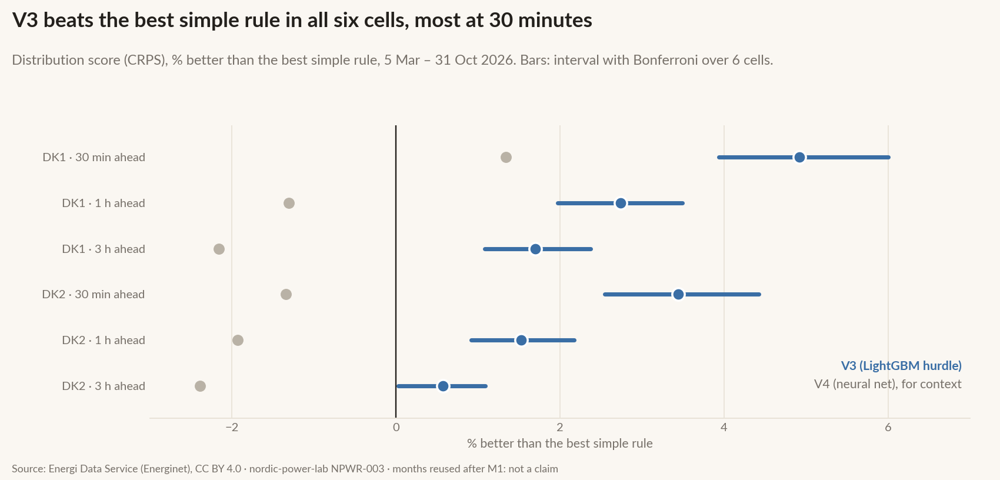

# Forecasting the Danish imbalance price 30 minutes to 3 hours ahead

*Status 21 Nov 2026 (revised after an independent audit, see the end). Backtest done; the selected model has run live since 13 Nov and is scored against
simple rules and, since amendment A5 (16 Nov, before any look), against a linear quantile regression on the same
inputs. The live comparison stays sealed until fixed dates (below).*

## The question
- For each 15-minute quarter in DK1 and DK2: what is the gap between the imbalance price and the day-ahead
  price, 30 min, 1 h and 3 h before the quarter starts?
- Why it matters: a balance-responsible party that is long or short at gate closure settles the difference at
  the imbalance price. The gap is the cost (or gain) of leaving a position open instead of closing it.
- Forecast a full distribution, not one number: probability of down / no / up regulation, plus 21 quantiles
  of the gap.

## What makes it hard
- **A point mass at zero.** If no mFRR activation dominates the quarter, the imbalance price equals the
  day-ahead price (Energinet's rule): 24% of 2026 quarters in DK1, 35% in DK2.
- **A heavy tail.** Tail index 1.8–2.5: gaps of several hundred EUR/MWh are routine. In 5 Mar – 31 Oct 2026,
  61 days in DK1 and 105 in DK2 had at least one quarter above 500 EUR/MWh.
- **The latest information is old.** The imbalance price appears 45 min after the quarter (median). Over 8 days
  of live polling, 7% of quarters were published later than 75 min (source delays on 12–14 Nov, up to 4 h 20 min).
  At issue time the newest usable gap is the quarter that started 75 min
  earlier. Its correlation with the target falls from 0.40/0.60 (15 min, DK1/DK2) to 0.07/0.15 (75 min).
- **Two structural breaks.** 15-minute day-ahead products from 1 Oct 2025; a new rule for the imbalance
  direction on 4 Mar 2026. Results are reported from 5 Mar 2026.

## Inputs (only what was public at issue time)
- Recent gaps and their price components (aFRR and mFRR prices of the last known quarter).
- Real-time system state with a measured 15-min lag: 1-minute aFRR activation in both areas over the last
  hour, realised wind and solar minus the day-ahead forecast, realised interconnector flows minus the
  day-ahead schedule.
- Target quarter: day-ahead price and its ramp inside the hour, position in the hour, hour of day, weekend.
- History before 7 Nov 2026 has no fetch times: the backtest uses final values with fixed availability lags
  (75 min for prices, 15 min for real-time data), measured on live polling. Fetch times are stored from 7 Nov on.

## How it is tested
- **Walk-forward.** Each month is forecast by models trained on data from Oct 2025 up to the day before that
  month; refit monthly with an expanding window.
- **Simple rules scored the same way.** "Gap = 0"; the training distribution; "gap = last known gap"; the
  distribution by quarter position and day-ahead ramp; the distribution by the current aFRR activation.
  A model has to beat the best of these in each cell. A stronger yardstick is a *model*, not a rule: a linear
  quantile regression on V3's own inputs (added after the backtest, see the table).
- **Scores.** CRPS (whole distribution, approximated by the quantile score on 21 levels) is primary; direction log loss, mean absolute error, the 1% and 99%
  quantile losses and P(|gap| > 100) are reported.
- **Uncertainty.** Day-block bootstrap; Bonferroni over the six area × horizon cells.
- **Written down first.** Each model and score was committed before its first run; every run is logged,
  including failures, and every departure from the plan is recorded with its reason.

## Round 1: a linear model fails its claim
- Pre-registered claim: a linear quantile model beats "gap = 0" on mean absolute error, 1 h and 3 h ahead.
- Result: worse in all four cells, by 0.35–0.60 EUR/MWh.
- Slightly better on direction (about 1%) and on the low end of the range (6–11%). These were secondary
  scores, so they are not claimed.
- Lesson: the mean absolute error rewards predicting zero; the useful information is in the shape of the
  distribution.

## Round 2: a three-part model that follows the price rule (V3)
- **Part 1, regime.** Gradient-boosted classifier: P(down), P(none), P(up).
- **Part 2, size given the regime.** Log of |gap| with a boosted location model and a boosted scale model
  trained on out-of-fold residuals.
- **Part 3, tail.** Empirical residuals up to their 95% quantile, a generalized Pareto distribution above.
- The three parts combine into a mixture, read off at 21 quantiles.

| Area | Ahead | CRPS vs best simple rule | CRPS vs trailing-window rule (audit) | CRPS vs linear model, same inputs | Mean absolute error |
|---|---|---|---|---|---|
| DK1 | 30 min | **4.9% better** | **3.5% better** | **1.8% better** | **2.7% better** |
| DK1 | 1 h | **2.7% better** | **2.1% better** | **0.7% better** | **1.1% better** |
| DK1 | 3 h | **1.7% better** | **1.4% better** | **0.5% better** | no difference |
| DK2 | 30 min | **3.4% better** | **3.0% better** | **1.9% better** | **1.4% better** |
| DK2 | 1 h | **1.5% better** | **1.4% better** | 0.4% better | no difference |
| DK2 | 3 h | **0.6% better** | 0.5% better | 0.2% better | no difference |

*Bold: the interval excludes zero. The audit's rules are refreshed daily on the last 28–120 days and conditioned
on the last known regime; they were picked on the test months, as the project's own rules were. Against them,
8–30% of the headline gain disappears, and DK2 3 h is no longer distinguishable from zero. The linear model
(exact linear quantile regression on all 32 V3 inputs; post hoc, 16 Nov) is the strongest yardstick in every
cell: against it 45–75% of the headline gain disappears, and DK2 1 h and 3 h are not distinguishable from zero.
At 1 h and 3 h the remaining margin is of the order of the model's seed noise (±0.1–0.3%). Most of the skill is in
the inputs, not in the non-linear model.*

- Direction log loss is 0.6–3.2% better, and the interval excludes zero in 5 of 6 cells.
- **Weak spot: the extreme upper tail.** The 99% quantile is 0–11% worse than the simple rules.
- **A boosted-tree model on the round-1 inputs does most of the work.** A plain quantile-boosting model without
  the three-part structure scores the same (within ±0.3%). The real-time inputs add only at 30 minutes, where
  they are freshest.
- **Where the gain is.** Mostly in quarters with large gaps (|gap| > 100 EUR/MWh, 16% of quarters): V3 forecasts
  the size of the risk better than the rules; it is only modestly better on the sign.
- **Not a claim.** These months had already been used for round 1, so this is a selection-aware backtest.
  The claim is tested only on new, live data.

## What did not help on top of V3

- **Sequence neural net.** A GRU over the raw last hour of 1-minute aFRR and 5-minute wind, solar and flow
  errors, plus V3's inputs; 3 seeds; Kaggle GPU. It came out 3.9% worse than V3 on average. Its 99% tail is
  better than V3's.
- **Stacking forecasts** (weights only from past months):
  - 50/50 averaging, past-month weights and a per-quarter switch did not help;
  - quantile regression over seven models gave +0.3% on average, with an interval excluding zero in 2 of 6
    cells. Mostly it repairs V3's tail.
- **Post-processing V3's residuals:**
  - quantile recalibration, correction from V3's own recent errors, and a second model on its errors were all
    worse (−0.4% to −2.2%);
  - V3's errors at the 75-minute publication lag are almost independent (correlation 0.04), so little is left
    to correct; month-to-month calibration shifts do not carry over.
- **Seven other model families** (Markov regime, persistence distribution, an aFRR-volume route, Student-t
  regression, nearest-neighbour analogues, quantile regression forest, NGBoost) were all worse than V3 in
  every cell; the best, the quantile forest, by about 1%. NGBoost with a Student-t output failed numerically
  (single forecasts with infinite tails), and with it the two pre-registered combiners that included it.
  Without it (a post-hoc check), online weighting ends up mostly on V3 and its simpler sibling: +0.2%, within
  noise.
- **Single-seed caveat.** Each model was fitted with one random seed; V3 refitted with other seeds moves by
  ±0.3%. Differences of that size above are not evidence.
- **Reading:** nothing tried reached +2% over V3. But V3 is not at the ceiling: averaging V3 with its two
  feature variants gains about 1% in every cell (found by the audit after the fact, so it is a candidate, not a
  result). Large further gains need new information, not more model.

## Is it worth money? Withdrawn and being redone
- An earlier version of this section said that V3 does not beat closing every wind error. That calculation was
  wrong: it charged the part of the wind error that cannot be closed only when the position was left open.
- **Corrected reading (descriptive, post hoc).** Only the error visible at gate closure can be closed. For that
  part, leaving it open when V3 expects a gain earned about 3.5 EUR per MWh of error in both areas (90% interval
  1.5–5.9). A one-line rule (leave it open when it has the sign of the current aFRR activation) earned 2.3–2.8,
  and the difference between the two is within noise. Half of the value came from five days.
- The day-ahead price stands in for the intraday close-out price; the bias this causes has an unknown sign.
- A new value study, with this accounting and one-line rules as comparators, will be pre-registered and run on
  new data before any money figure is claimed.

## Live test (running)
- V3 issues forecasts every 15 minutes beside the simple rules; scores are computed daily.
- **Sealed until fixed dates**, so nothing is tuned on live results:
  - 18 Dec 2026, a descriptive look (28 days);
  - 18 Feb 2027, the decision (90 days).
- **Minimum detectable effect** (from the backtest bootstrap): 2.2–4.1% CRPS at 28 days, 1.2–2.3% at 90 days.
  A true gain of 1–2% may need the full 90 days. Against the linear model the backtest margin at 1 h and 3 h
  (0.2–0.7%) is below the 90-day detectable effect, so the live test will most likely *not* show a gain over it
  in those cells; this is stated in advance.

## Round 3: reading the regime from mFRR activations (backtest, then live)
- Energinet publishes mFRR energy activations per quarter, usually within minutes of its start; history exists
  from March 2025. Adding the activations of the previous quarter (always published by issue time) to V3:

| Area | 30 min | 1 h | 3 h |
|---|---|---|---|
| DK1 | **+3.8%** | **+1.2%** | +0.4% |
| DK2 | **+2.4%** | **+1.0%** | +0.2% |

  *CRPS gain over V3, same reused months; bold: interval excludes zero.*
- **Live version.** At real issue times the newest quarter is still unpublished in ~18% of cases, and the
  activation prices arrive 30–45 minutes later. A version trained for that (no activation prices, the newest
  quarter hidden in 18% of training rows) keeps +2.2% / +0.8% (DK1, 30 min / 1 h). It runs live since
  15 Nov 2026 next to V3, under a protocol amendment frozen before its first forecast.
- **Where the value is.** For the wind close-out decision, a one-line rule on the same activation feed earns most
  of what the model earns; the model's extra margin is within noise. The information is in the feed.

## External factors (screen, no effect)
- Pre-registered factors tested as additions to V3's spike probability (|gap| > 100 EUR/MWh): weather-model
  disagreement, wind-forecast ramps, storms, neighbours' imbalance, lightning, holidays and DST, geomagnetic
  storms (Kp) and World Cup matches. None improved the forecast in either area. (Two further factors use data
  whose publication terms are still being confirmed and are not reported.)

## Independent audit (15 Nov 2026)
- A second model (Claude Fable 5.2, high reasoning) re-checked the whole study from the data with its own code.
- Confirmed: V3's forecasts reproduce bit for bit; every input respects its stated lag; no leakage in V3.
- Changed here as a result: the stronger rule comparison, the price-lag figures, the history-vintage
  statement, the "ceiling" reading, the seed caveat, and the withdrawn money section.

*Data: Energi Data Service (Energinet), CC BY 4.0; ENTSO-E Transparency Platform. Code available on request.*
