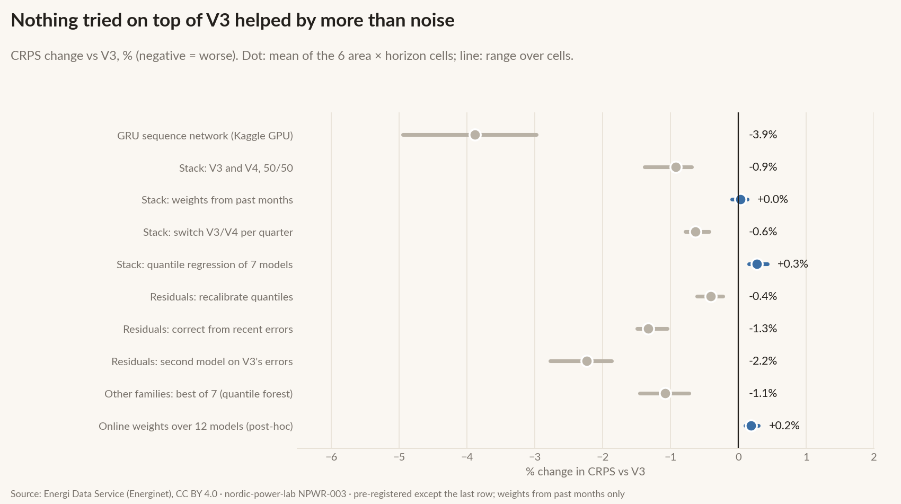

# Forecasting the Danish imbalance price 30 minutes to 3 hours ahead

*Status 13 Nov 2026. Backtest done; the selected model has run live since 13 Nov and is scored against
simple rules. The live comparison stays sealed until fixed dates (below).*

## The question
- For each 15-minute quarter in DK1 and DK2: what is the gap between the imbalance price and the day-ahead
  price, 30 min, 1 h and 3 h before the quarter starts?
- Why it matters: a balance-responsible party that is long or short at gate closure settles the difference at
  the imbalance price. The gap is the cost (or gain) of leaving a position open instead of closing it.
- Forecast a full distribution, not one number: probability of down / no / up regulation, plus 21 quantiles
  of the gap.

## What makes it hard
- **A point mass at zero.** If no mFRR activation dominates the quarter, the imbalance price equals the
  day-ahead price (Energinet's rule): 24% of 2026 quarters in DK1, 35% in DK2.
- **A heavy tail.** Tail index 1.8–2.5: gaps of several hundred EUR/MWh are routine. In 5 Mar – 31 Oct 2026,
  61 days in DK1 and 105 in DK2 had at least one quarter above 500 EUR/MWh.
- **The latest information is old.** The imbalance price appears 45 min after the quarter (median; p99 60 min,
  measured live over 824 quarters). At issue time the newest usable gap is the quarter that started 75 min
  earlier. Its correlation with the target falls from 0.40/0.60 (15 min, DK1/DK2) to 0.07/0.15 (75 min).
- **Two structural breaks.** 15-minute day-ahead products from 1 Oct 2025; a new rule for the imbalance
  direction on 4 Mar 2026. Results are reported from 5 Mar 2026.

## Inputs (only what was public at issue time)
- Recent gaps and their price components (aFRR and mFRR prices of the last known quarter).
- Real-time system state with a measured 15-min lag: 1-minute aFRR activation in both areas over the last
  hour, realised wind and solar minus the day-ahead forecast, realised interconnector flows minus the
  day-ahead schedule.
- Target quarter: day-ahead price and its ramp inside the hour, position in the hour, hour of day, weekend.
- Every source is stored with the time it was fetched, so the backtest only sees what was known then.

## How it is tested
- **Walk-forward.** Each month is forecast by models trained on data from Oct 2025 up to the day before that
  month; refit monthly with an expanding window.
- **Simple rules scored the same way.** "Gap = 0"; the training distribution; "gap = last known gap"; the
  distribution by quarter position and day-ahead ramp; the distribution by the current aFRR activation.
  A model has to beat the best of these in each cell.
- **Scores.** CRPS (whole distribution) is primary; direction log loss, mean absolute error, the 1% and 99%
  quantile losses and P(|gap| > 100) are reported.
- **Uncertainty.** Day-block bootstrap; Bonferroni over the six area × horizon cells.
- **Written down first.** Each model and score was committed before its first run; every run is logged,
  including failures, and every departure from the plan is recorded with its reason.

## Round 1: a linear model fails its claim
- Pre-registered claim: a linear quantile model beats "gap = 0" on mean absolute error, 1 h and 3 h ahead.
- Result: worse in all four cells, by 0.35–0.60 EUR/MWh.
- Slightly better on direction (about 1%) and on the low end of the range (6–11%). These were secondary
  scores, so they are not claimed.
- Lesson: the mean absolute error rewards predicting zero; the useful information is in the shape of the
  distribution.

## Round 2: a three-part model that follows the price rule (V3)
- **Part 1, regime.** Gradient-boosted classifier: P(down), P(none), P(up).
- **Part 2, size given the regime.** Log of |gap| with a boosted location model and a boosted scale model
  trained on out-of-fold residuals.
- **Part 3, tail.** Empirical residuals up to their 95% quantile, a generalized Pareto distribution above.
- The three parts combine into a mixture, read off at 21 quantiles.

| Area | Ahead | CRPS vs best simple rule | Mean absolute error |
|---|---|---|---|
| DK1 | 30 min | **4.9% better** | **2.7% better** |
| DK1 | 1 h | **2.7% better** | **1.1% better** |
| DK1 | 3 h | **1.7% better** | no difference |
| DK2 | 30 min | **3.4% better** | **1.4% better** |
| DK2 | 1 h | **1.5% better** | no difference |
| DK2 | 3 h | **0.6% better** | no difference |

*Bold: the interval excludes zero.*

- Direction log loss is 0.6–3.2% better, and the interval excludes zero in 5 of 6 cells.
- **Weak spot: the extreme upper tail.** The 99% quantile is 0–11% worse than the simple rules.
- **The structure does most of the work.** The same model on the round-1 inputs comes close; the real-time
  inputs add mainly at 30 minutes, where they are freshest.
- **Not a claim.** These months had already been used for round 1, so this is a selection-aware backtest.
  The claim is tested only on new, live data.

## What did not help on top of V3

- **Sequence neural net.** A GRU over the raw last hour of 1-minute aFRR and 5-minute wind, solar and flow
  errors, plus V3's inputs; 3 seeds; Kaggle GPU. It came out 3.9% worse than V3 on average. Its 99% tail is
  better than V3's.
- **Stacking forecasts** (weights only from past months):
  - 50/50 averaging, past-month weights and a per-quarter switch did not help;
  - quantile regression over seven models gave +0.3% on average, with an interval excluding zero in 2 of 6
    cells. Mostly it repairs V3's tail.
- **Post-processing V3's residuals:**
  - quantile recalibration, correction from V3's own recent errors, and a second model on its errors were all
    worse (−0.4% to −2.2%);
  - V3's errors at the 75-minute publication lag are almost independent (correlation 0.04), so little is left
    to correct; month-to-month calibration shifts do not carry over.
- **Seven other model families** (Markov regime, persistence distribution, an aFRR-volume route, Student-t
  regression, nearest-neighbour analogues, quantile regression forest, NGBoost) were all worse than V3 in
  every cell; the best, the quantile forest, by about 1%. NGBoost with a Student-t output failed numerically
  (single forecasts with infinite tails), and with it the two pre-registered combiners that included it.
  Without it (a post-hoc check), online weighting ends up mostly on V3 and its simpler sibling: +0.2%, within
  noise.
- **Reading:** with these inputs V3 is near the ceiling. Further gains need new information, not more model.

## Is it worth money? A wind portfolio's close-out decision
- **Setting.** Each area's wind fleet is sold day-ahead at its forecast. At gate closure (60 min before the
  quarter) it either closes its current error or leaves it to imbalance settlement.
- **Leaving errors open is costly.** It costs 7.5 EUR per MWh of error in DK1 and 22 in DK2: wind errors are
  usually on the wrong side of the system.
- **V3 does not beat closing everything.** Using V3 to choose which errors to leave open gives DK1 +0.4 EUR/MWh
  (interval includes zero) and DK2 −5.7.
- **The decision itself has value.** A perfect sign forecast would be worth 21–26 EUR/MWh.
- **Caveats.** The day-ahead price stands in for the intraday close-out price (this overstates both the cost
  and the oracle gap); closing is assumed free and unlimited.

## Live test (running)
- V3 issues forecasts every 15 minutes beside the simple rules; scores are computed daily.
- **Sealed until fixed dates**, so nothing is tuned on live results:
  - 18 Dec 2026, a descriptive look (28 days);
  - 18 Feb 2027, the decision (90 days).
- **Minimum detectable effect** (from the backtest bootstrap): 2.2–4.1% CRPS at 28 days, 1.2–2.3% at 90 days.
  A true gain of 1–2% may need the full 90 days.

## Next
- **Read the regime instead of predicting it.** Energinet publishes mFRR activations before the price. If they
  arrive early enough, the sign of the current quarter becomes known 35–50 minutes before its price. The
  arrival times are being measured now.

*Data: Energi Data Service (Energinet), CC BY 4.0; ENTSO-E Transparency Platform. Code available on request.*
